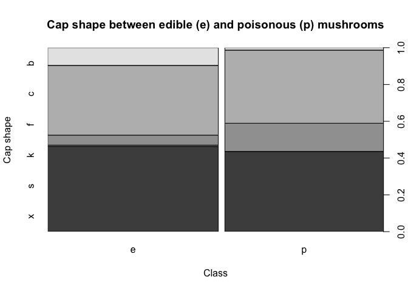

GLM
================
PGB
2026-10-11

# Generalised Linear Models (GLM)

In this file I will explore the abilities of Generalised Linear Models
(GLM). In simple (or multivariate) linear regression, the inputs and
outputs are both on a continuous scale, and their relationship are
modelled as linear, meaning the expected output changes at a constant
rate as the input changes, when other predictors are held constant. In
generalised linear modelling, we give our inputs and outputs free reign,
so that they can be non-continuous (and even categorical), while still
imposing a linear relationship. The table below describes different
types of models and their related inputs, outputs and response
distribution.

| Model | Input $X$ | Output $Y$ | Typical response distribution |
|----|----|----|----|
| Gaussian linear regression | Continuous or categorical | Continuous | Gaussian |
| Logistic regression | Continuous or categorical | Binary (0/1) | Bernoulli / Binomial |
| Poisson regression | Continuous or categorical | Discrete counts (0, 1, 2, …) | Poisson |
| Gamma regression | Continuous or categorical | Positive continuous | Gamma |

In order to apply linear modeling to data that is originally
non-continuous, a link function connects the expected output to a linear
model, allowing us to model outcomes such as binary values or counts.
The link function transforms the conditional mean of the response
variable onto a scale where it can be expressed as a linear function of
the predictors.

The simplest example would be if you had a continuous input variable,
and a binary output. For example, can we model heart disease (binary
output: present/absent) using measured continuous data such as blood
pressure, blood sugar levels, weight, waist circumference, etc? In GLM
we can, by transforming the output of the linear model to a binary value
(0 or 1), representing disease state. We do this transformation using a
link function.

The GLM model consists of the expectation of the conditional (response):

$$
E[y_i \mid \underline{x}_i, \theta] = \mu_i
$$

And the latent variable (inputs/covariates):

$$
\eta_i = \beta_0 + \beta_1 x_{i,1} + \cdots + \beta_p x_{i,p}.
$$

We relate $$\mu_i$$ to $$\eta_i$$ by transforming the expected value
using the link function. Or, more practically, we transform the inputs
($$\eta_i$$) by the inverse of the link function to return the output in
a format that we can interpret directly. The inverse of a function is
the operation that reverses the original function. So if a function
doubles a value, the inverse will halve a value.

The latent variable is a weighted linear combination of the covariates.
It will be a real-valued vector. This is then transformed through the
link function to relate to the response variable. The type of link
function is determined by the type of output variable.

## Logistic regression

When the outcome is binary (0/1), we use logistic regression and the
logit link function to adapt the latent variable. The logit function can
be written as log\[mu_i/1-mu_i\]. The inverse of the logit is the
sigmoid function and can be written as 1/(1+exp(-latent)).

## Poisson

Poisson regression concerns (positive) count data. Here the log link
function is simply log(mu_i) with the inverse link as exp(latent).

As with linear regression, GLM aims to find the best estimates for the
regression coefficients given observed responses and features. And also,
as with linear regression, we can use [ordinary least
squares](https://github.com/PlantsGenesBugs/OLS_parameter_estimation) or
[maximum likelihood
estimation](https://github.com/PlantsGenesBugs/Max_Likelihood_Estimation)
for these parameters. In some cases we might have to use iteratively
reweighted least squares estimation. When doing MLE, an analytical
solution is not possible, and therefore a numerical approach is used.

Below I will apply a glm to the Mushroom dataset available at the
University of California, Irvine’s [Machine Learning
Repository](https://archive.ics.uci.edu/dataset/73/mushroom). According
to the website:

> “This data set includes descriptions of hypothetical samples
> corresponding to 23 species of gilled mushrooms in the Agaricus and
> Lepiota Family (pp. 500-525). Each species is identified as definitely
> edible, definitely poisonous, or of unknown edibility and not
> recommended. This latter class was combined with the poisonous one.
> The Guide clearly states that there is no simple rule for determining
> the edibility of a mushroom…”

Below we will attempt to combine features of these mushrooms to describe
whether a given mushroom is poisonous or not.

``` r
# download data from website: https://archive.ics.uci.edu/dataset/73/mushroom
# unzip data

# load data
mushroom_data <- read.csv("mushroom/agaricus-lepiota.data", header = FALSE, stringsAsFactors = TRUE)

# assign column names according to source website
names(mushroom_data) <- c(
  "class", "cap_shape", "cap_surface", "cap_color",
  "bruises", "odor", "gill_attachment", "gill_spacing",
  "gill_size", "gill_color", "stalk_shape", "stalk_root",
  "stalk_surface_above_ring", "stalk_surface_below_ring",
  "stalk_color_above_ring", "stalk_color_below_ring",
  "veil_type", "veil_color", "ring_number", "ring_type",
  "spore_print_color", "population", "habitat"
)

# take a look at class and cap shape
plot(mushroom_data$class, mushroom_data$cap_shape,
     main = "Cap shape between edible (e) and poisonous (p) mushrooms",
     xlab = "Class",
     ylab = "Cap shape")
```

<!-- -->
Column 1 (“class”) contains our output variable - poisonous (p) or
edible (e). The other columns contain categorical or binary data, such
as cap shape (6 different shapes observed) or gill size (binary - broad
or narrow).

We can now fit a logistic regression model that takes in one, some, or
all of the categorical variables, specifying the appropriate link
function. The link function relates to the **outcome** variable. Here
our outcome is binary, so we will choose to use the logit link function.

``` r
mushroom_class_glm <- glm(class ~ cap_shape, family = binomial(link = logit),
    data = mushroom_data)

summary(mushroom_class_glm)
```

    ## 
    ## Call:
    ## glm(formula = class ~ cap_shape, family = binomial(link = logit), 
    ##     data = mushroom_data)
    ## 
    ## Coefficients:
    ##             Estimate Std. Error z value Pr(>|z|)    
    ## (Intercept)  -2.1302     0.1527 -13.953   <2e-16 ***
    ## cap_shapec   16.6963   441.3717   0.038    0.970    
    ## cap_shapef    2.1048     0.1568  13.426   <2e-16 ***
    ## cap_shapek    3.0978     0.1714  18.079   <2e-16 ***
    ## cap_shapes  -12.4359   156.0485  -0.080    0.936    
    ## cap_shapex    1.9987     0.1562  12.794   <2e-16 ***
    ## ---
    ## Signif. codes:  0 '***' 0.001 '**' 0.01 '*' 0.05 '.' 0.1 ' ' 1
    ## 
    ## (Dispersion parameter for binomial family taken to be 1)
    ## 
    ##     Null deviance: 11252  on 8123  degrees of freedom
    ## Residual deviance: 10702  on 8118  degrees of freedom
    ## AIC: 10714
    ## 
    ## Number of Fisher Scoring iterations: 13

The model returns an estimate of the regression coefficient for each
covariate on the log-odds scale. In this case, the cap shape had 6
different factors and so the glm() function turned these into 6
individual covariates with either a 0 or 1 value assigned to them based
on presence/absence in that particular mushroom. A positive coefficient
means higher log-odds of being poisonous relative to the reference
category. A negative coefficient means lower log-odds relative to the
reference category.

The 6 cap shapes are b, c, f, k, s and x. The intercept reflects the
estimated log-odds of a mushroom being poisonous if it has cap shape b.
Every other coefficient is relative to this. It is often easier to
interpret these values when we convert them to odds ratios. To do this
we will exponentiate the coefficient.
